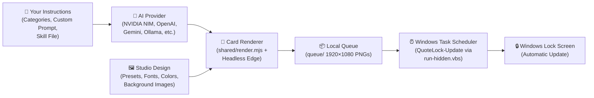

<div align="center">

# 🔒 QuoteLock

**An autonomous Windows lock screen quote engine & visual design studio.**  
*Wake up to a fresh, AI-curated, beautifully typeset quote on your laptop's lock screen — automatically.*

[](#)
[](#)
[](#)
[](#where-to-paste-your-api-key)

<br/>

<a href="https://github.com/Surya17155/Quote-lock/releases/latest/download/QuoteLock.Setup.0.1.0.exe">
  
</a>

<sub>Windows 10 / 11 (64-bit) · <a href="https://github.com/Surya17155/Quote-lock/releases/latest">View all releases</a> · Or <a href="#-quick-start">run from source</a></sub>

</div>

---

## ⬇️ One-Click Windows Install

1. Click **[Download QuoteLock for Windows (.exe)](https://github.com/Surya17155/Quote-lock/releases/latest/download/QuoteLock.Setup.0.1.0.exe)** *(or grab the latest `.exe` from [Releases](https://github.com/Surya17155/Quote-lock/releases/latest))*.
2. Run **`QuoteLock Setup 0.1.0.exe`** (no Node.js or coding tools required).
3. Open **QuoteLock** from your Desktop or Start Menu, paste your API key in **Settings**, and turn on **QuoteLock activity** — your lock screen updates automatically from there.

> [!NOTE]
> If Windows SmartScreen asks for confirmation on first run (since the installer is unsigned), click **More info → Run anyway**.

---

## 🎬 1-Minute Walkthrough Video

New to QuoteLock? Watch this quick **1-minute overview** to see how the autonomous lock screen engine and QuoteLock Studio work together:

https://github.com/user-attachments/assets/e042b18f-53ec-4ea5-84fd-f3d9edb8725d

<div align="center">

<a href="https://github.com/Surya17155/Quote-lock/blob/main/docs/quotelock-final.mp4">
  
</a>

<sub><a href="https://github.com/Surya17155/Quote-lock/blob/main/docs/quotelock-final.mp4">Watch on GitHub</a> · <a href="https://github.com/Surya17155/Quote-lock/raw/main/docs/quotelock-final.mp4">Download MP4 (5.6 MB)</a></sub>

</div>

---

## ✨ What is QuoteLock?

**QuoteLock is not just a manual wallpaper setter.** It is an **autonomous background system** for Windows 10/11 that:

1. **Generates** thoughtful quotes tailored to your personal instructions, categories, or custom prompt file.
2. **Renders** each quote into a crisp `1920×1080` PNG card using HTML/CSS typography and headless Microsoft Edge.
3. **Queues** upcoming cards ahead of time so your lock screen never waits on a network call.
4. **Publishes** a new lock screen automatically in the background via a Windows Scheduled Task (`QuoteLock-Update`) — on session unlock, daily, and every 30 minutes — without popping up any terminal windows.

You also get **QuoteLock Studio**, a modern desktop app (Electron + React) where you can design your card's typography, colors, layouts, and background images with a live preview, manage your AI provider & API key, and inspect your quote queue.

---

## ⚙️ How It Works (Architecture)



<details>
<summary><strong>🔍 Click to explore what each component does under the hood</strong></summary>

| Component | File / Folder | Role |
| :--- | :--- | :--- |
| **Background Engine** | `app.ps1` | PowerShell engine that calls your AI provider, manages `queue/` & `shown/`, renders PNGs, and updates the Windows lock screen registry/policies. |
| **Silent Runner** | `run-hidden.vbs` | Launches `app.ps1` with zero visible PowerShell console windows. |
| **Card Renderer** | `shared/render.mjs` & `shared/card.mjs` | Builds the HTML/CSS quote card and captures a `1920×1080` screenshot via headless Microsoft Edge. |
| **Provider Registry** | `shared/providers.json` | Defines supported AI endpoints (NVIDIA NIM, OpenAI, OpenRouter, Groq, Together, DeepSeek, Mistral, xAI, Google Gemini, Anthropic, Ollama, Custom). |
| **Desktop Studio** | `studio/` | Electron + React + Tailwind app for live card design, provider/key setup, library management, and schedule monitoring. |
| **Local Config** | `config.json` *(git-ignored)* | Stores your API key, selected model, prompt instructions, and Studio appearance settings locally on your PC. |

</details>

---

## 🚀 Quick Start

### Prerequisites
- **Windows 10 or Windows 11**
- **Node.js 20+** and **npm**
- **Microsoft Edge** (pre-installed on Windows — used for headless card rendering)
- An **API key** from any supported AI provider *(or **Ollama** running locally with no key required)*

### Option A: Run QuoteLock Studio from Source

```powershell
# 1. Clone the repository
git clone https://github.com/Surya17155/Quote-lock.git
cd Quote-lock

# 2. Install Studio dependencies and launch
cd studio
npm install
npm run dev
```

### Option B: Build a Windows Installer (`.exe`)

```powershell
cd studio
npm install
npm run icon
npm run dist
```

This creates `studio/release/QuoteLock Setup <version>.exe`, which installs QuoteLock to `%LOCALAPPDATA%\Programs\QuoteLock` with Desktop & Start Menu shortcuts.

### Option C: Install the Autonomous Background Task (CLI)

If you want to register or repair the `QuoteLock-Update` Windows Scheduled Task directly:

```powershell
powershell -NoProfile -ExecutionPolicy Bypass -File app.ps1 -Setup
```

Other useful engine flags:
- `-Generate` — Generate & queue new quote cards now
- `-Regenerate` — Re-render existing queued cards with your latest design
- `-Publish <path-to-png>` — Immediately publish a specific card to your lock screen
- `-SelfTest` — Verify rendering & setup
- `-On` / `-Off` — Enable or pause QuoteLock's background task

---

## 🔑 How to Use Your API Key & Where to Paste It

Your API key stays **100% local on your machine** in `config.json` (which is excluded by `.gitignore` and never committed).

### Method 1: Paste it in QuoteLock Studio (Recommended)
1. Open **QuoteLock Studio**.
2. Go to **Settings** (sidebar) → **AI Provider**.
3. Pick your provider (default is **NVIDIA NIM**, or choose **OpenAI**, **OpenRouter**, **Groq**, **Google Gemini**, **Anthropic**, **DeepSeek**, **Mistral**, **xAI**, **Together AI**, **Ollama**, or **Custom**).
4. **Paste your API key** into the API Key input field and click **Save**.
5. Click **Fetch models** (or type a model ID) and select your preferred model.

### Method 2: Paste it in `config.json`
If you prefer editing config files directly:
1. Copy `config.example.json` to `config.json` in the root folder:
   ```powershell
   Copy-Item config.example.json config.json
   ```
2. Open `config.json` and paste your key into `"apiKey"`:
   ```json
   {
     "apiKey": "PASTE_YOUR_API_KEY_HERE",
     "model": "nvidia/nemotron-3.5-lightning-30b-a3b",
     "mode": "quotes",
     "categories": ["Motivation", "Stoicism", "Discipline", "Wisdom"],
     "daysAhead": 2
   }
   ```

> [!IMPORTANT]
> Never commit `config.json` or paste real API keys into any tracked file. `config.json` is already listed in `.gitignore`.

---

## ✍️ Customizing Your Quotes & Card Design

### 1. Tell the AI What Quotes You Want
Inside **Settings → Content guidance** (or `config.json`):
- **Categories**: Pick or customize topics like `Stoicism`, `Discipline`, `Science`, `Creativity`, etc.
- **Instructions (`description`)**: Write natural-language guidance — e.g., *"Short, punchy engineering wisdom with no clichés"* or *"Morning stoic reminders under 15 words"*.
- **Skill / Prompt File (`skillPath`)**: Point QuoteLock to a custom `.md` or `.txt` prompt file for full control over tone, format, and style.
- **Web Research & Thinking**: Toggle web-grounded inspiration and reasoning mode if your model supports it.

### 2. Design Your Lock Screen Card in Studio
Open the **Studio** tab to customize:
- **Presets & Palettes**: Switch between curated dark/light themes or set custom hex colors.
- **Typography**: Choose your font family (`Segoe Script`, serif, monospace, etc.), font scale, and line height.
- **Backgrounds**: Solid colors, angled gradients, or **your own background images** (stored in `assets/user/`) with adjustable blur, dim, and focal position.
- **Layouts & Accents**: Center, editorial, or minimal layouts; optional quote marks, accent rule, and footer.

---

## 🧑‍💻 Vibe Coding: Make QuoteLock Yours

QuoteLock is built to be **easily remixed with AI coding agents**. If you enjoy vibe coding:

1. **Copy this repository URL**: `https://github.com/Surya17155/Quote-lock`
2. **Give it to your AI agent** (Cursor, Antigravity, Claude Code, Windsurf, etc.) and ask it to customize anything you want!

### Ideas You Can Try Next
- 🖼️ **Custom Image + Code Overlays**: Add your own photography in `assets/user/` and ask your AI agent to build glassmorphic cards, split-screen layouts, or magazine-style typography on top.
- 🌤️ **Live Context on Your Lock Screen**: Extend `shared/card.mjs` to show today's weather, a coding streak counter, or a countdown to a launch date alongside your quote.
- 📚 **Personal Highlights Sync**: Import quotes from your Notion, Readwise, Obsidian vault, or Kindle clippings instead of generating new ones.
- 🎨 **Time-of-Day Themes**: Automatically switch between a bright morning palette and a calm midnight palette based on the current hour.
- 🔁 **Multi-Monitor / Desktop Wallpaper Mode**: Extend `app.ps1` to also update your desktop wallpaper or generate ultrawide (`2560×1080` / `3840×2160`) cards.

---

## 📁 Project Structure

```text
QuoteLock/
├── app.ps1                # Autonomous PowerShell engine & Windows Task Scheduler setup
├── run-hidden.vbs         # Silent background launcher
├── config.example.json    # Safe template for your local config.json
├── filter.txt             # Quote filtering rules
├── shared/
│   ├── card.mjs           # HTML/CSS card template builder
│   ├── render.mjs         # Headless Edge PNG renderer
│   └── providers.json     # Supported AI provider definitions
└── studio/                # Electron + React + Tailwind desktop app
    ├── electron/          # Main & preload processes
    ├── src/               # React UI (Home, Studio, Library, Schedule, Activity, Settings)
    └── scripts/           # Build, icon, and UI audit scripts
```

---
